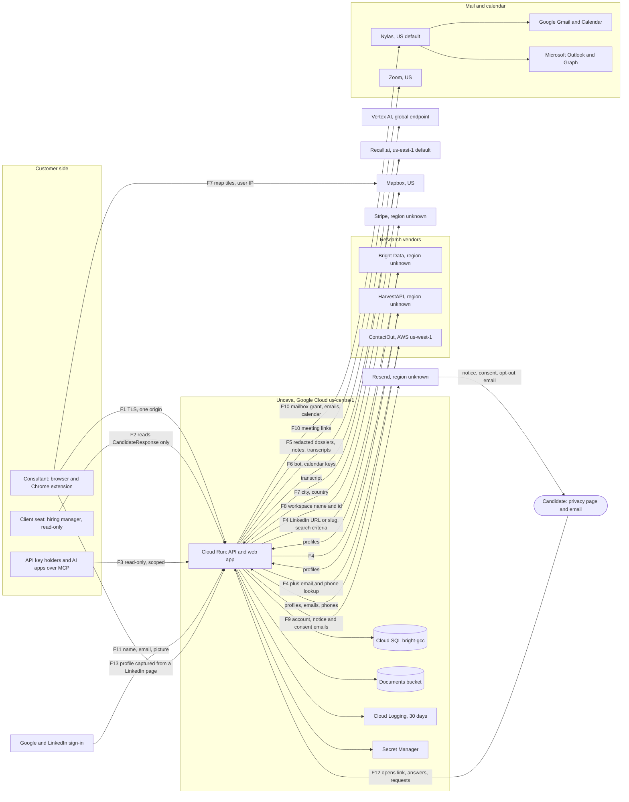
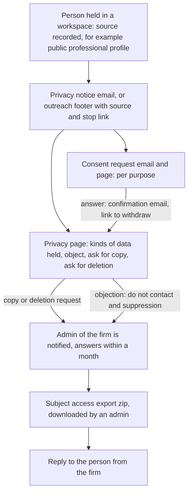

# Data flow map

_Draft for counsel, 2026-11-19, unreviewed. Requested by Alac Partners (gap analysis §5b, item 3: data movement between
Uncava, clients and providers; internal, shown to clients' compliance teams on request). Built only from
[subprocessors.md](subprocessors.md), [residency-adr.md](residency-adr.md), [tia.md](tia.md) and `ropa.md`. A region not
stated there is **[Region]**; a fact the repository cannot give is **[Owner to confirm]**. Transfer mechanisms are
undecided (decision F1), so every transfer note says so. Nothing is hosted in the UAE._

## 1. Overview

## 2. The candidate's own touchpoints

## 3. Flows

Stored: **Y** held by Uncava, **T** transient (passes through, not kept by Uncava), **V** held by the recipient (its
retention is [Owner to confirm] unless stated).

| Flow | Data | Purpose | Region | Transfer note | Stored |
|---|---|---|---|---|---|
| F1. Consultant to API, and API to Cloud SQL, bucket and Secret Manager | everything a firm enters: people, notes, documents, outreach, transcripts, accounts; secrets and keysets (no personal data) | run the service | Google Cloud `us-central1` (Cloud Run, Cloud SQL single zone, bucket); Secret Manager project-level | transfer to the US for any UAE, EU or UK person; mechanism [DPF / SCCs] (F1). TLS from browser to Cloud Run; connector to Cloud SQL; Google-managed keys at rest | Y |
| F1b. Logs | masked application lines; Cloud Run request URLs, including `?q=` searches | operate and fix the service | Cloud Logging `_Default`, `global` | as above; 30 days (decision F10 open) | Y, 30 days |
| F2. Client seat to API | the read-only `CandidateResponse` for attached positions; never notes, documents, tasks, assessments, AI readings or contacts | the client reads its own mandate | `us-central1` | as F1 | Y (the same rows) |
| F3. API keys and AI apps over MCP to API | what the key's scopes and the owner's live permissions allow, read-only | the customer's own integrations | `us-central1` out to the customer's chosen recipient | the customer's recipient, not Uncava's sub-processor | T |
| F4. API to Bright Data, HarvestAPI, ContactOut, and back | out: a LinkedIn URL or slug, company, function, title or name search criteria; ContactOut also a look-up key for email and phone. Back: profile record, work email, phone | find and pre-fill executive profiles; reveal a contact on a consultant's click | Bright Data [Region]; HarvestAPI [Region]; ContactOut AWS `us-west-1` (vendor-stated, not verified) | Uncava is a controller of what ContactOut returns; ContactOut is an independent controller of it (`ropa.md` UAE addendum); mechanism [DPF / SCCs]; ContactOut's written approval for storage is requested, not granted | Y: shared cache 30 days (`app_lm_vendor_*`); the vendor's answer per person while the person is held (`app_lm_person_vendor_record`); revealed contacts on the person. V at vendors: [Owner to confirm] |
| F5. API to Vertex AI | candidate dossiers, notes, CV text and call transcripts with contacts removed (`ContactRedaction`); position briefs; assistant chats. Compensation and custom columns never sent | AI enrichment, drafts, summaries, assistant | `global`: Google may serve from any region ([residency-adr.md](residency-adr.md) §1) | no named region; Google states no training on customer data; mechanism [DPF / SCCs]; whether Google retains prompts: [Owner to confirm] | T at Uncava; results are stored with the person |
| F6. API and Recall.ai | out: calendar OAuth keys and refresh token, bot instructions. In: each call's audio and video, Recall's transcription. Recall deletes the audio once the transcript is filed | the Notetaker and live copilot | `us-east-1` by default (`RECALL_BASE_URL`); EU is a separate account | US transfer; mechanism [DPF / SCCs]; recording consent is not yet captured in the register before the bot joins (gap analysis P8) | Y: transcript at Uncava per `lightmove.recall.transcript-retention`; V audio, short-lived |
| F7. Mapbox | server: a company's city and country. Browser: map styles and tiles; the user's IP and a billing session | map and geocode | US | mechanism [DPF / SCCs]; performance metrics off | Y: geocoding cache 30 days (`app_lm_geocoded_place`); V at Mapbox |
| F8. API to Stripe | workspace name and id; Checkout collects the payer's card, address and tax id directly | billing | [Region] | Stripe may act as controller for payments; mechanism [DPF / SCCs] | Y (usage events, credit ledger); card data V at Stripe only |
| F9. API to Resend | users' names and addresses (verification, reset, invitation, lockout, two-factor, billing, export, purge); notification emails naming candidates; candidates' privacy notices and consent requests, sent as "{firm} via Uncava" | email | [Region] | mechanism [DPF / SCCs]; the candidate's address is never recorded beside a notice | T at Uncava; V at Resend: [Owner to confirm] |
| F10. API to Nylas, Google, Microsoft, Zoom | the mailbox grant, outreach emails and replies in threads Uncava sent, calendar events, meeting links; a booking-page visitor's IP and details | outreach and meetings from the consultant's own mailbox | Nylas US by default (`api.us.nylas.com`; EU available); Google and Microsoft: their own; Zoom US | Google, Microsoft and Zoom are the customer's own providers; mechanism [DPF / SCCs] for Nylas | Y: the outreach ledger with the person; grants sealed with Tink |
| F11. Sign-in providers to API | name, email, picture | sign-in with Google or LinkedIn | Google, LinkedIn: not stated | the user's own provider | Y (account) |
| F12. Candidate to privacy page | the link's token; the person's choices (object, copy, deletion, consent answers); the page shows kinds of data held, never values | notice, rights and consent | `us-central1` | a candidate in the UAE, EU or UK reaches a US service | Y (the answers, with the person) |
| F13. Chrome extension to API | a profile captured from a page the consultant is viewing | file a person into the workspace | `us-central1` | as F1 | Y |
| F14. Company universe | the Apollo ETL loads companies, not people, into `app_lm_apollo_companies` | company search | `us-central1`; Apollo US | holds no personal data; Apollo receives nothing from the app | Y |

## 4. Not a recipient

Cloudflare (DNS only, proxy off, no personal data), Google Fonts (self-hosted fonts), Firebase Hosting (serves the
website, not the app).

## 5. Open points

| Point | State |
|---|---|
| Regions of Resend, Stripe, Bright Data, HarvestAPI | decision F2 open: [Region] |
| Whether Nylas and Recall run on their US defaults in production | the code default is US; [Owner to confirm] |
| Transfer mechanism per recipient, DPA signed | decisions F1, `subprocessors.md` contracts table, all unfilled |
| Who sees what, by role | [access-control-policy.md](access-control-policy.md) |

## 6. Gaps

1. Four suppliers have no stated region.
2. Vertex AI has no named region (global endpoint), so a customer's residency question cannot be answered with a
   location until the triggers in [residency-adr.md](residency-adr.md) §1 fire.
3. No transfer mechanism or signed DPA is recorded for any supplier.
4. ContactOut's region and role are vendor-stated and unverified; its storage approval is pending.
5. The supplier-side retention of Resend, Nylas, Stripe, Mapbox, Vertex and the research vendors is not recorded.
6. The map is maintained by hand; there is no test that keeps it in step with the code (the Content-Security-Policy
   and `subprocessors.md` review are the nearest controls).
